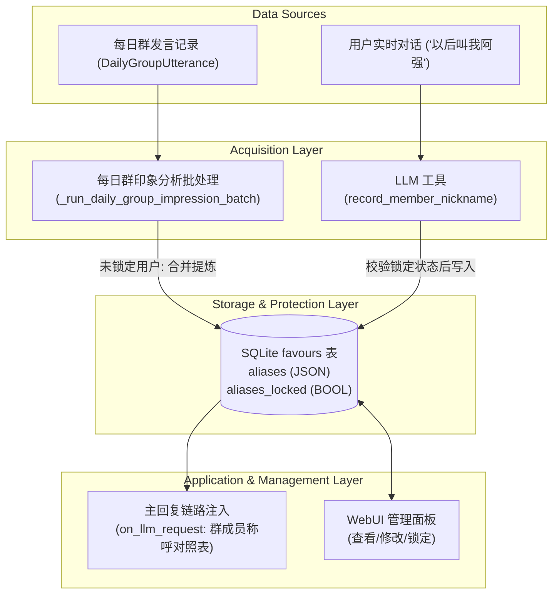

# 群聊成员昵称/外号识别与双向指代系统设计规范

## 1. 背景与目标

在 AstrBot 的群聊交互中，群成员常常使用简称、梗名、外号（如“猫猫”、“牢尤”、“阿强”）相互称呼，而机器人在缺乏称呼映射时：
1. 无法理解用户日常发言中提及的“某外号”究竟对应哪位群成员，导致上下文推断与好感度/印象认知断裂；
2. 机器人在自身回复中仅能生硬使用 QQ 原始昵称或 UID，缺乏群友之间自然的称谓感。

本设计旨在为 `astrbot_plugin_Favour_Ultra` 建立一套完整的群友昵称/别名生命周期管理体系，涵盖：
- **每日离线分析提取**：在每日活跃印象提取时，同时提炼群成员之间的常用指代称呼；
- **在线实时对话学习**：提供 LLM Function Calling 工具，支持用户在对话中明确告知称谓时即时沉淀；
- **双向感知与使用**：群聊主回复链路自动注入当前群昵称映射表，使大模型既能听懂代指，也能主动使用；
- **WebUI 人工管理与锁定**：支持在可视化界面中查看、编辑、新增、删除别名，并支持对单个用户的昵称进行锁定（Locked），防止自动分析覆盖。

---

## 2. 总体架构与数据流



---

## 3. 数据模型设计

在 `storage.py` 的 `FavourRecord` 模型中增加以下字段：

| 字段名 | 类型 | 默认值 | 说明 |
| :--- | :--- | :--- | :--- |
| `aliases` | `Text` (JSON string) | `'[]'` | 用户在该会话下的别名列表 `list[str]`，如 `["牢尤", "猫猫"]` |
| `aliases_locked` | `Boolean` | `False` | 别名锁定状态。若为 `True`，每日自动分析不再增改该用户别名 |

### 会话与作用域规则
- **全局好感度开启 (`is_global_favour == True`)**：
  别名和锁定状态存储在 `session_id = "global"` 的记录中，所有群聊及私聊共享相同的别名池。
- **全局好感度关闭 (`is_global_favour == False`)**：
  别名和锁定状态严格按群隔离存储在 `session_id = group_id` 的记录中。

### 数据库自动迁移
在 `storage.py` 的 `_init_db` / 初始化阶段，执行兼容检查：
- 检查 `favours` 表是否存在 `aliases` 与 `aliases_locked` 字段；
- 若不存在，执行 `ALTER TABLE favours ADD COLUMN aliases TEXT DEFAULT '[]'` 及 `ALTER TABLE favours ADD COLUMN aliases_locked BOOLEAN DEFAULT 0`。

---

## 4. 详细模块设计

### 4.1 每日分析联合提炼模块

1. **Prompt 改造 (`_build_group_impression_prompt`)**：
   要求大模型一次性输出结构化 JSON：
   ```json
   {
     "10001": {
       "impression": "爱吐槽的加班打工人",
       "aliases": ["牢尤", "猫猫"]
     },
     "10002": {
       "impression": "高频造梗气氛组",
       "aliases": ["咕师傅"]
     }
   }
   ```
2. **负向约束规则**：
   - 提取必须是其他成员在真实交互中用来呼叫、指代该特定成员的专有称谓、外号、简称或梗名；
   - 严禁提取无针对性的泛化称谓（如：`哥们`、`大哥`、`兄弟`、`老板`、`佬`、`群主`、`管理`、`机器人`、`大家` 等）；
   - 若当天没有出现特定指代外号，`aliases` 必须输出为空数组 `[]`；
   - 单个别名长度限制在 1~10 个字符以内。
3. **合并与入库 (`_run_daily_group_impression_batch`)**：
   - 遍历解析结果，读取目标用户的当前记录；
   - 若 `record.aliases_locked == True`，跳过别名更新，保留其人工设定的既有别名；
   - 若未锁定：读取既有别名列表，与新提取别名合并去重（大小写不敏感匹配，保留原始书写），最大保留 5 个最高频/最新别名；
   - 更新数据库并记录审计日志。

### 4.2 LLM 实时昵称学习工具 (`record_member_nickname`)

1. **注册与签名**：
   ```python
   @filter.llm_tool(name="record_member_nickname")
   async def record_member_nickname(
       self,
       event: AstrMessageEvent,
       nickname: str,
       target_user: str = "self",
       user_id: str = "",
   ) -> str:
       """当用户在对话中明确指定某个人的称呼/外号/昵称（例如：'以后叫我阿强'、'尤约拉猫叫猫猫'）时调用。"""
   ```
2. **目标用户推断优先级**：
   - **Case 1: 用户指定自己**（`target_user` 为 `"self"`、`"me"`、`"我"` 或包含当前用户名）：
     目标 UID 即为发送者 `event.get_sender_id()`。
   - **Case 2: 消息中包含 At 组件**：
     提取被 @ 用户的 QQ 号作为目标 UID。
   - **Case 3: 明确传入 `user_id`**：
     若传入有效数字 UID，直接采用。
   - **Case 4: 用户名模糊匹配**：
     在当前群内发言记录及好感表中，按 `user_name` 匹配目标成员。
3. **锁定与更新逻辑**：
   - 查询目标记录：若 `aliases_locked == True`，返回失败原因：`"用户 {target_name} 的昵称已被管理员锁定，无法通过对话修改"`；
   - 若未锁定：将清洗后的 `nickname` 追加至别名列表（去重，超出上限剔除最旧元素），写入数据库；
   - 返回成功文本：`"成功为用户 {target_name}({target_uid}) 记录称呼: {nickname}"`，供 LLM 自然回复给用户。

### 4.3 实时对话上下文注入模块 (`on_llm_request`)

在群聊回复准备阶段：
1. 查询当前会话中存在别名的成员记录（最多注入活跃度前 15 名成员，确保 Token 开销不超过 100 Tokens）；
2. 在系统提示词中注入：
   ```text
   【当前群成员常用称呼/外号对照表】
   - 尤约拉猫 (UID: 210916859): 常用称呼: [牢尤, 猫猫]
   - 咕咕 (UID: 10002): 常用称呼: [咕师傅]

   指代指引：
   1. 当其他群友在发言中提及上述称呼时，理解其指代对应成员及其好感/印象背景；
   2. 你在回复中提及这些群友时，可自然、亲切地选用这些常用称呼指代他们。
   ```
3. 在说话者自身的“用户信息”区块补充展示其常用称呼。

### 4.4 WebUI 管理与锁定模块

1. **列表展示**：
   - 好感度数据表格增加【常用称呼/外号】列，使用 Vue Chip 标签渲染已有别名；
   - 每行展示锁定图标按钮（🔒 已锁定 / 🔓 未锁定），点击可切换锁定状态。
2. **编辑对话框**：
   - 点击称呼列触发编辑弹窗（遵循规范 `text-h3 pa-4 pb-0 pl-6`，按钮使用 `variant="text"` / `variant="tonal"`）；
   - 支持动态新增 Tag、删除单个 Tag；
   - 包含【锁定此用户昵称】开关。
3. **API 接口**：
   - `POST /api/favour/user/aliases`：
     - 请求体：`{"user_id": str, "session_id": str, "aliases": list[str], "locked": bool}`
     - 校验并更新数据库对应记录，返回最新状态。

---

## 5. 错误处理与容错保障

1. **LLM 格式容错**：
   - 解析大模型返回的群印象 JSON 时，做双模式兼容：既支持新版 `{"uid": {"impression": "...", "aliases": [...]}}`，也向后兼容旧版 `{"uid": "..."}`（兼容旧提示词或微调异常情况）。
2. **并发与脏写防护**：
   - 别名更新操作在同一个数据库事务内完成原子写入。
3. **特殊字符与注入防护**：
   - 别名过滤控制字符、换行符、反引号及 Markdown 特殊语法，限制单标签长度 <= 10 字符，单用户最多 5 个标签。

---

## 6. 测试与验证计划

1. **单元测试 (`tests/test_nickname_aliases.py`)**：
   - 测试每日印象提示词生成包含别名提取要求；
   - 测试 JSON 解析器兼容复合结构与旧扁平结构；
   - 测试锁定机制：已锁定用户在每日分析中别名不被改动；
   - 测试增量合并去重与长度上限逻辑；
   - 测试 LLM 工具 `record_member_nickname` 针对“自己”、“@他人”、“模糊匹配他人”及“锁定拒绝”分支；
   - 测试 `on_llm_request` 上下文注入格式正确性。
2. **集成与生产验证**：
   - 运行全部测试套件确保无回归错误；
   - 推送至服务器加载并验证 WebUI API 与页面正常工作。
